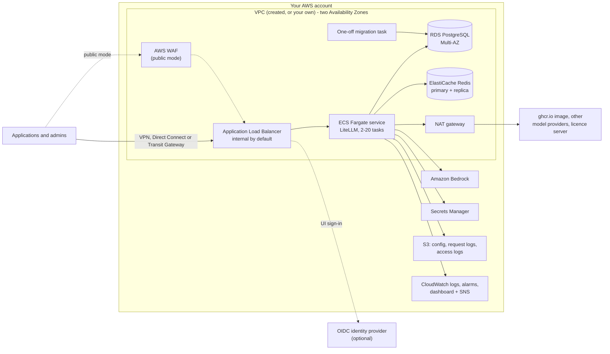

# Guidance for Multi-Provider Generative AI Gateway on AWS

This Guidance runs the open-source [LiteLLM](https://docs.litellm.ai/) proxy as a private, highly available gateway
in your AWS account, deployed with Terraform. Applications call one OpenAI-compatible endpoint; LiteLLM routes the
calls to Amazon Bedrock and other model providers, and handles virtual API keys, teams, budgets, rate limits, spend
tracking and its admin UI.

The Guidance hosts the official, unmodified LiteLLM container image. It adds no code to the request path; it
provides the AWS infrastructure, secure defaults and operating procedures around it.

## Architecture

1. Clients reach an Application Load Balancer. By default it is internal: reachable only from the VPC and the
   client ranges or security groups you admit (VPN, AWS Direct Connect, AWS Transit Gateway, or the optional demo
   AWS Client VPN). In public mode the load balancer is internet-facing and AWS WAF is attached.
2. HTTPS terminates on the load balancer with your AWS Certificate Manager (ACM) certificate. When an identity
   provider is configured, the load balancer requires OIDC sign-in in front of the LiteLLM UI paths; API paths use
   LiteLLM virtual keys.
3. LiteLLM runs on Amazon ECS on AWS Fargate (Graviton, two tasks minimum across two Availability Zones, CPU and
   memory target-tracking scaling up to 20 tasks). Every rollout first runs the database schema migration as a
   one-off task; the service only rolls if it succeeds, and the deployment circuit breaker rolls back a failed
   rollout.
4. Amazon RDS for PostgreSQL stores keys, teams, budgets, spend and models added through the UI or API. Amazon
   ElastiCache (Redis OSS) holds shared rate-limit and routing state and the response cache.
5. Generated credentials (master key, salt key, UI password, database URL, Redis token) live only in AWS Secrets
   Manager and reach the tasks as secret references; they never appear in Terraform variables or state.
6. Terraform renders the LiteLLM configuration and stores it in Amazon S3; request metadata (not prompts or
   responses) is logged to S3; Amazon CloudWatch holds logs, alarms and a dashboard, with alarm notifications
   through Amazon SNS.
7. LiteLLM calls Amazon Bedrock with its task role. Pulling the image from ghcr.io, other model providers, the
   LiteLLM licence server and the identity provider need outbound internet access through the NAT gateway (or
   your own egress).

## Getting started

Follow [docs/setup.md](docs/setup.md). The fastest path is the trial deployment: private, plain HTTP, reached
through a demo Client VPN, ready in one `deploy/deploy.sh` run.

## Documentation

| Page | Contents |
| --- | --- |
| [docs/setup.md](docs/setup.md) | Prerequisites, deployment options (trial, private, public), identity provider, demo VPN, first model, verification |
| [docs/operations.md](docs/operations.md) | Upgrades, configuration changes, generated secrets, licence, monitoring, backups and teardown, troubleshooting |
| [docs/reference.md](docs/reference.md) | Every Terraform input and output |
| [terraform/modules/observability/README.md](terraform/modules/observability/README.md) | Alarms and dashboard |
| [LiteLLM documentation](https://docs.litellm.ai/) | Everything LiteLLM itself does: models, keys, teams, budgets, guardrails, SSO |

## Repository layout

| Path | Contents |
| --- | --- |
| `terraform/foundation` | Long-lived network and data: VPC (created or your own), RDS, Redis, Secrets Manager, config bucket, optional customer KMS key, optional demo Client VPN |
| `terraform/app` | Load balancer, WAF, ECS service and migration task, rendered LiteLLM config, IAM, logs, alarms; destroyable and redeployable against a living foundation |
| `terraform/modules` | Child modules: `observability`, `vpn`, `rollout` |
| `deploy/` | `deploy.sh`, `undeploy.sh`, `smoke-test.sh`, `setup-vpn.sh`, `mirror-image.sh`, and the `terraform.tfvars.example` both roots read |
| `examples/` | Integrations built on a deployed gateway |

## Examples

- [examples/agentcore/](examples/agentcore/): using the gateway from Amazon Bedrock AgentCore.
- [examples/eks/](examples/eks/): running the gateway on an existing Amazon EKS cluster (a non-production starting point).

## Cost

You pay for the AWS resources the deployment runs and for model usage. The main hourly cost drivers are the NAT
gateway, the Application Load Balancer, two or more Fargate tasks (2 vCPU, 4 GiB each), the Multi-AZ
`db.t4g.large` RDS instance, two `cache.t3.micro` Redis nodes and, when enabled, interface VPC endpoints (per
endpoint and Availability Zone), AWS WAF and the demo Client VPN (per association and connected client). Usage
costs come from Amazon Bedrock and other model providers, CloudWatch Logs ingestion and storage (logs are retained
for ten years) and S3. Estimate with the [AWS Pricing Calculator](https://calculator.aws/). The LiteLLM Enterprise
licence, if you use one, is billed by its vendor.

## Security

The defaults are private networking, TLS on the load balancer, least-privilege IAM roles, encryption at rest for
every data store, generated secrets kept out of Terraform state, message logging turned off and deletion
protection on. Weakening them (public mode, plain HTTP, DEBUG logging) takes an explicit input; public mode without
an identity provider and DEBUG logging also print a warning on every plan. See
[CONTRIBUTING](CONTRIBUTING.md#security-issue-notifications) to report a security issue.

The foundation creates an empty AWS CloudFormation stack (`<deployment_name>-tracking-stack`) whose description
carries the Guidance's solution ID; AWS uses it to count deployments of this Guidance.

## Open source libraries

See [ATTRIBUTION](ATTRIBUTION.md).

## Notices

Customers are responsible for making their own independent assessment of the information in this Guidance. This
Guidance: (a) is for informational purposes only, (b) represents AWS current product offerings and practices,
which are subject to change without notice, and (c) does not create any commitments or assurances from AWS and its
affiliates, suppliers or licensors. AWS products or services are provided "as is" without warranties,
representations, or conditions of any kind, whether express or implied. AWS responsibilities and liabilities to its
customers are controlled by AWS agreements, and this Guidance is not part of, nor does it modify, any agreement
between AWS and its customers.
