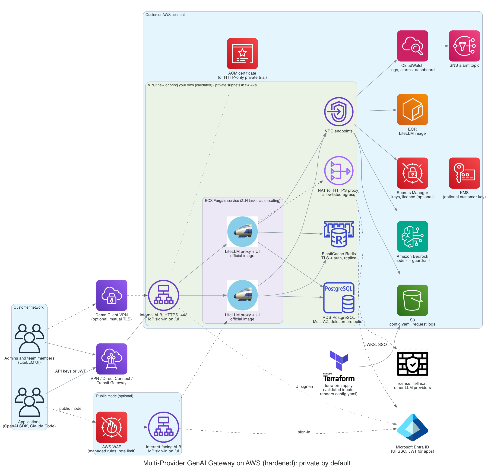

# A production-ready, lightweight Multi-Provider GenAI Gateway on AWS

| | |
|---|---|
| Starting point | [Guidance for Multi-Provider Generative AI Gateway on AWS](https://github.com/aws-solutions-library-samples/guidance-for-multi-provider-generative-ai-gateway-on-aws) ("the WWSO Gateway"), `main` at `122b72d`, LiteLLM 1.82.3 |
| Date | 2026-10-19 |
| Decisions since | See [decisions.md](decisions.md) — milestone split, IdP sign-in always on, the minimal EKS example and its Milestone 1 compatibility constraint. Where it conflicts with this doc, the decision log wins |

## 0. Background and motivation

**What GEH is, and why it matters here.**
- GenAI Enterprise Hub (GEH) is an AWS gateway and catalog solution built on LiteLLM, the open-source LLM gateway. It runs in regulated customer environments.
- GEH is being sunset.
- This plan carries its production lessons over to the WWSO Gateway, an AWS Solutions Library sample that also hosts LiteLLM on AWS.

**The goal: an accelerator.** The aim is a starting blueprint that is production-ready out of the box but adds very little custom code.
- It is LiteLLM as it is, plus secure AWS infrastructure.
- Field engineering teams then customise it per customer. For example, they can add CloudFront back for a customer who really wants a public deployment behind it.

**The motivation: do more with less.**
- Custom code next to LiteLLM rots. LiteLLM ships several releases a week, and every one can break code that wraps, patches or re-implements it.
- Keeping up is an endless chase, and it only works with a dedicated maintainer team behind that code.
- The WWSO Gateway's middleware shows the problem. It is about 1,200 lines that already return wrong status codes, drop tool calls and no longer build (2.1).
- GEH hit the same pitfalls with its own service layer around LiteLLM: an API, a console and an authorization layer, plus local patches to LiteLLM, all of which had to be re-checked and ported on every LiteLLM upgrade.
- So this plan removes what LiteLLM or AWS already does, and invests in what makes the gateway safe to run.

In practice, the simplification means:
- **No CloudFront:** the load balancer is the only entry point.
- **ECS only:** no EKS option.
- **No middleware:** LiteLLM handles every request directly.

**Safe to try, ready for production.**
- The trial options let anyone experiment safely, in their own account and without corporate prerequisites:
  - no LiteLLM licence
  - no DNS or certificate (plain HTTP, private only)
  - no identity provider
  - a demo VPN for access
- Their counterparts are what make the gateway production-ready:
  - the LiteLLM Enterprise licence, which production needs (2.9)
  - the customer's certificate and DNS
  - the customer's identity provider, for example Entra ID
  - the customer's own network: Direct Connect, Transit Gateway or VPN

Claims marked "tested" were checked with local runs of the official LiteLLM image (1.82.3 and 1.106.0) and Terraform tests with mocked providers, without an AWS account; anything else that is unproven is marked **UNVERIFIED**.

---

## 1. Summary of the core changes

**Simplify:**
1. **Remove the middleware.** LiteLLM handles every request directly.
2. **Remove CloudFront.** The load balancer is the only entry point.
3. **Remove EKS.** ECS Fargate is the only compute option.
4. **Remove the AppRegistry application**, which makes every new deployment fail.

**Network and access:**

5. **Private by default, with identity-provider sign-in in front of the LiteLLM UI in both modes.** An optional public mode flips the load balancer to internet-facing and adds WAF.
6. **TLS with the customer's certificate.** A DNS-less, certificate-less mode is allowed for private trials only.
7. **Bring your own VPC**, with explicit subnets that are validated before anything is created.
8. **An optional demo Client VPN** with a setup script, instead of an internet-facing SSH bastion.

**Identity and licence:**

9. **Licensed or reduced mode.** Reduced mode, without a licence, is for trials and exploration. **Production readiness needs the LiteLLM Enterprise licence**, which gates SSO beyond 5 users, JWT auth for applications, per-team guardrails and audit logs.
10. **The customer's identity provider (Entra ID or any OIDC provider)** for UI sign-in, API tokens and public-mode sign-in.

**Security and data protection:**

11. **Safe logging:** no prompts or secrets in the logs.
12. **Secrets only in Secrets Manager:** never in variables, Terraform state or terminal output.
13. **Least-privilege IAM.**
14. **An optional customer KMS key; deletion protection, backups and a final snapshot.**
15. **Tags on every resource, and unique names** so two deployments in one account don't collide.

**Operations:**

16. **Alarms and a dashboard**, built from AWS metrics only.
17. **The LiteLLM config is rendered by Terraform**, and a config change rolls the tasks.
18. **Thin deploy scripts** with a reviewed plan, plus a minimal smoke test.
19. **CI quality gates:** formatting, validation, tests, linting, security and secret scanning, and dependency updates.
20. **Documentation:** a Setup guide and a Maintenance guide, linking to the LiteLLM docs for everything LiteLLM does.

Nice-to-have follow-ups, kept separate from the core, are in section 5: a one-off migration task, graceful shutdown, and upstream image handling.

---

## 2. Each core change in detail

### 2.1 Remove the middleware

**Today:** every task runs a second container next to LiteLLM.
- It is a custom FastAPI app of about 1,200 lines.
- Load-balancer rules send these paths to it:
  - the OpenAI chat paths
  - all `/bedrock/model/*` paths
  - `/key/generate` and `/user/new`
  - its history paths
- It calls LiteLLM on `localhost`.

**What each piece does, and whether LiteLLM covers it:**

| Function | What it does | Covered by LiteLLM? | Decision |
|---|---|---|---|
| OpenAI chat proxy (`/v1/chat/completions`, `/chat/completions`) | Re-sends calls to LiteLLM, adding history and prompt handling | Yes: it is LiteLLM's own endpoint | **Remove.** Tested: it returns **HTTP 200 for LiteLLM's 401 and 400 errors**, streaming and not, which breaks client error handling and retries |
| Bedrock Converse facade (`/bedrock/model/{id}/converse[-stream]`) | Translates Bedrock Converse to OpenAI format and back | Yes: LiteLLM's built-in Bedrock pass-through (Converse, Invoke, streaming), free | **Remove.** Tested: the facade drops `toolConfig` (and images and documents). LiteLLM's own route keeps it, signs the request, enforces LiteLLM authentication and rejects unregistered models |
| Bedrock Prompt Management (a prompt ARN used as the model ID) | Fetches the prompt template from Bedrock and fills in the variables | **No.** Tested: neither LiteLLM version has this integration | **Remove; a feature is lost.** Clients fetch the prompt themselves, or use LiteLLM's own prompt management (UNVERIFIED as a replacement) |
| Server-side chat history (`session_id`, `/chat-history`, `/session-ids`) | Stores whole conversations in Postgres, keyed to a hash of the API key | Partly. Client-side history is the OpenAI-standard pattern. LiteLLM's Responses API has `previous_response_id` (UNVERIFIED) | **Remove; a feature is lost.** Tested: **callers with invalid keys can write history rows.** History also grows without bound |
| `/key/generate` | Pure pass-through | Yes | **Remove.** Nothing is lost |
| `/user/new` with Okta | Swaps an Okta token for the **master key** and creates a user. The caller still chooses their own budget and teams | Replaced by LiteLLM's own SSO, with just-in-time users and key-generation limits | **Remove.** Tested: it **writes the caller's bearer token (the master key) to the log** |
| Health check, permissive CORS | Supports the container itself | N/A | Remove |

The middleware also no longer starts. **A fresh build crashes at startup**, because its dependencies are unpinned and a new SQLAlchemy release needs a database driver it doesn't install. The container is marked essential, so every task would fail.

**Change:**
- Delete the container, its routing, its image repository and its log group.
- Delete the three test suites that only test middleware features. A minimal smoke test replaces them (2.18).
- Existing middleware data stays in the database for the customer to export.

**Custom code left in the request path:** none. Removing server-side history and prompt ARNs is a breaking change and must be announced.

### 2.2 Remove CloudFront

**Today:** CloudFront is the default entry point.
- It reaches the load balancer **over plain HTTP across the internet**, gated only by a shared header.
- The WAF is never attached to CloudFront.
- No origin response timeout is set, so CloudFront's default applies: it waits **30 s** for the first byte of a response, and between packets, then fails the request. For `POST` requests it does not retry. Non-streaming LLM calls often take longer. The timeout can be set from 1 to 120 s, and higher with a quota increase ([origin settings](https://docs.aws.amazon.com/AmazonCloudFront/latest/DeveloperGuide/DownloadDistValuesOrigin.html#DownloadDistValuesOriginResponseTimeout), [quotas](https://docs.aws.amazon.com/AmazonCloudFront/latest/DeveloperGuide/cloudfront-limits.html#limits-web-distributions)).

**Why:** an API gateway gains nothing from a content delivery network. CloudFront adds an unencrypted hop, a second authentication mechanism, and a timeout that's too short. Field teams can still add it back for a specific customer.

**Change:** delete CloudFront and its header rules.

### 2.3 Remove EKS

**Today:** the stack can deploy to EKS instead of ECS.
- A second set of Kubernetes manifests, a Helm-installed load-balancer controller and a public Kubernetes API endpoint.
- Bedrock permissions on the node role, so every pod on a node gets them.
- Kubernetes 1.32, now on paid extended support.

**Why:** a stateless proxy gains nothing from Kubernetes here. A second compute option doubles what has to be tested and maintained. Teams that need EKS can port the single container definition.

**Change:** remove the EKS module, its providers, its VPC endpoints and its paths in the scripts. Existing ECS deployments keep their Terraform state addresses.

**Decided 2026-10-29:** a minimal, explicitly non-production EKS *example* (bring-your-own cluster, plain manifests outside the Terraform stack) comes in Milestone 2 — see [decisions.md](decisions.md), including the compatibility constraint it puts on Milestone 1.

**Tested:** `terraform validate` after the removal.

### 2.4 Remove the AppRegistry application

**Today:** the Service Catalog AppRegistry resource returns 403 in accounts that never used AppRegistry, which is now in maintenance mode. Every new deployment fails.

**Change:** remove it. The empty CloudFormation stack stays: its only job is to carry the guidance's solution ID (SO9022) in its description, which is how the AWS Solutions Library counts deployments. It creates nothing and costs nothing. It should be documented, and dropped if the accelerator is distributed outside the Solutions Library.

### 2.5 Private by default, with identity-provider sign-in in both modes

**Why private by default:** experience from GEH showed that most customers who want an LLM gateway come from highly regulated industries and require a private deployment. So private is the default, and public mode is a variant: the same stack with the load balancer flipped to internet-facing, plus WAF.

**Today:**
- The load balancer is public by default.
- The admin UI is reachable from the internet, protected only by the master key, which is also the UI password.
- In private mode, any `10/8`, `172.16/12` or `192.168/16` address may connect.
- One documented mode forwards plain HTTP straight to LiteLLM.

**Change:**
- **Private** (the default): an internal load balancer. Only the VPC, or listed client ranges, can reach it.
- **Public** (the variant): the load balancer is internet-facing, and the WAF is attached:
  - managed rules, IP reputation and a per-IP rate limit
  - the body-size rule stays at count-only, because LLM requests routinely exceed its 8 KB limit
- **Sign-in in both modes:** when an identity provider is configured, the load balancer requires sign-in with it before the LiteLLM UI is reachable (its OIDC authentication action). **Decided 2026-10-29:** it applies unconditionally in both modes, so the public/private × sign-in combination validations below are dropped ([decisions.md](decisions.md)).
  - The load balancer's OIDC action only works for browsers, so it covers the UI and sign-in paths.
  - API paths stay on LiteLLM's own authentication: virtual keys, or JWT with a licence.
  - With no identity provider configured, as in the trial, there is no load-balancer sign-in, and the UI uses LiteLLM's own admin login. The HTTP-only trial can't have it anyway, because the OIDC action needs HTTPS.
- HTTP redirects to HTTPS.

**Tested:** `terraform test` checks that:
- public mode without sign-in is rejected
- private mode with an identity provider plans the sign-in rule
- the trial has none
- sign-in combined with plain HTTP is rejected

The sign-in flow itself is UNVERIFIED.

### 2.6 TLS, and a DNS-less, certificate-less private trial

**Today:**
- Without a certificate, a **self-signed certificate** is created, which teaches users to turn off TLS verification.
- The DNS options are tangled: Route 53 zones are created or imported, and the deploy script guesses settings for backward compatibility.

**Change:**
- The customer's certificate is required, unless the insecure-HTTP switch is set.
- That switch is **rejected in public mode**. It serves plain HTTP for private proofs of concept only.
- DNS is optional: give a hosted zone and a name to get an alias record. Otherwise clients use the load balancer's own DNS name.

**Tested:** `terraform test` covers:
- public mode with insecure HTTP (rejected)
- a missing certificate (rejected)
- a zone without a name (rejected)
- the trial profile, which plans with an `http://` URL

### 2.7 Bring your own VPC, with validation

**Today:** an existing VPC's subnets are **guessed** from their route tables. Every subnet without an internet route counts as private, whether it is a data subnet, a single-AZ subnet or anything else. Nothing is checked.

**Change:** the private and public subnets are listed explicitly and checked before anything is created.

The plan **fails** on:
- fewer than 2 subnets or Availability Zones
- subnets outside the VPC
- "private" subnets with an internet route or public IPs
- public mode without public subnets in 2 AZs
- too few free IP addresses for rolling deploys, the load balancer, endpoints, the database and Redis
- VPC DNS turned off in private mode

It **warns** on:
- low IP headroom
- no outbound route and no proxy
- missing VPC endpoints

**Tested:** 11 `terraform test` cases with a mocked AWS provider. One of them caught a real bug: a crash on the empty route fields AWS returns.

Existing bring-your-own-VPC users must list their subnets; the validation tells them which.

### 2.8 The demo Client VPN, with a setup script

**Today:** an optional EC2 bastion with a **public IP and SSH open to the internet**, plus an installer for Cloud9, which is closed to new customers.

**Change:**
- An optional AWS Client VPN into the VPC, off by default, for demos and tests only:
  - certificate-based authentication with one shared client certificate
  - split tunnel and the VPC's DNS
  - access to the VPC range only
  - connection logs
- A setup script creates the certificates locally, imports them into AWS Certificate Manager, and later writes a ready-to-import VPN profile.
- The bastion and the Cloud9 script are removed.

**Tested:**
- The certificate generation (the chains verify, with the correct key usage).
- Module validation, linting and 6 mocked test cases.
- A real connection is UNVERIFIED.

### 2.9 Licensed or reduced mode

**Today:** there is no licence handling. The gateway avoids every Enterprise feature.

**Change:**
- An optional licence secret. `LITELLM_LICENSE` is set only when the secret is given.
- Without it, the gateway runs in reduced mode: virtual keys, teams, budgets, rate limits, and SSO for up to 5 users.
- **Reduced mode is for trials and exploration only. Production readiness needs the Enterprise licence**, because it gates the controls a production gateway needs: SSO beyond 5 users, JWT auth for applications, per-team guardrails and audit logs.
- Adding the licence later is a configuration change, with no rebuild.
- The plan warns if Enterprise-only settings are configured without a licence.

**Tested:**
- On 1.106.0 without a licence, an API call with a JWT gets **403** ("enterprise only"), while virtual keys keep working.
- `terraform test` shows the licence variable is set only when a licence is given.

### 2.10 The customer's identity provider

**Today:** only the middleware's Okta self-signup (2.1). There is no SSO for the UI.

**Change:** the gateway uses LiteLLM's own features at up to three points, all pointing at the customer's provider (for example Entra ID):
1. **UI sign-in.** Free for up to 5 users.
2. **API tokens for applications**, using the OAuth client-credentials flow. Enterprise only.
3. **Load-balancer sign-in in front of the UI**, in both modes (2.5).

Client IDs are passed as plain settings and client secrets as Secrets Manager ARNs. A dedicated identity-provider input is the next step.

**Tested:** the licence gate (2.9). Real Entra SSO and token flows are UNVERIFIED. The Setup guide needs pages for the app registrations.

### 2.11 Safe logging

**Today:**
- LiteLLM runs at DEBUG level, set in two places, with extra debug flags on.
- The database logs every SQL statement.

**Tested with the WWSO configuration:**
- On 1.82.3, one request wrote the **prompt to the logs 10 times**, and the **Redis password was printed in clear text** at startup.
- On 1.106.0 at DEBUG, the prompt is still logged 7 times.

**Change:**
- The log level is INFO by default. DEBUG is allowed temporarily, and the plan warns when it is on.
- JSON logs, with message logging turned off for every logging callback.
- The database logs only schema changes and slow queries.
- Logs are kept for 90 days by default.

**Tested:** 0 prompt or secret occurrences with the new settings, on both versions.

### 2.12 Secrets only in Secrets Manager

**Today:**
- 20 provider API keys pass through deploy variables into Terraform state.
- **The deploy scripts print every provider key to the terminal.**
- The Redis password is a plain environment variable.
- The UI password is the master key.
- Deleted secrets can't be recovered.

**Change:**
- Provider keys are given as Secrets Manager ARNs, so the keys themselves never appear in variables or state.
- The Redis password and a separate generated UI password are secrets.
- Deleted secrets have a 7-day recovery window.
- The salt key is documented as never to be rotated, because rotating it makes stored credentials unreadable.

**Tested:**
- Without a separate UI password, the master key logs into the UI. With one, the master key is refused.
- `terraform test` checks the secret wiring.

The identity provider's client secret for load-balancer sign-in still lands in Terraform state, because the AWS API needs the value. Keep the state encrypted and access-controlled.

### 2.13 Least-privilege IAM

**Today:** the task role may call **any Bedrock action** (`bedrock:*`) on any resource, with full access to the log bucket. The other roles use `*` or AWS's full-access policies.

**Change:**
- **Task role:**
  - Bedrock inference and guardrails only, on any model or inference profile in any region, so new regions and cross-region profiles keep working.
  - Optional model and region allowlists.
  - Write-only access to the log bucket, and read-only access to the config file.
  - Cross-account roles must be listed explicitly; a wildcard is rejected.
- **The other roles:** scoped to the image repository, the log group and the named secrets.

Whether every LiteLLM Bedrock path is covered is UNVERIFIED.

### 2.14 KMS, deletion protection and backups

**Today:** the database can be deleted, with no final snapshot. Backup retention is left at the default, and buckets are force-deleted.

**Change:**
- Deletion protection (on by default) covers the database and the load balancer, and keeps buckets on destroy.
- A final snapshot on destroy, and 30-day backups.
- Database changes wait for the maintenance window.
- One optional customer KMS key covers the database, Redis, secrets, logs and S3.
- The config bucket is versioned.

**Not done yet:**
- PostgreSQL 17 for new deployments (today: 15).
- Forced TLS to the database (UNVERIFIED with LiteLLM).
- The KMS key-policy grants.

### 2.15 Tags and unique names

**Today:** several names are fixed: the parameter group, the subnet group, the WAF and the tracking stack. A second deployment in the same account collides. The tags are partly placeholders.

**Change:** every name derives from the deployment name. Every resource is tagged with the deployment, the tool, and the customer's own tags.

### 2.16 Alarms and a dashboard

**Today:** no alarms and no dashboard.

**Change:**
- 16 alarms, modelled on GEH's thresholds:
  - load balancer: error rate, latency, unhealthy hosts
  - ECS: running tasks, CPU, memory
  - database: CPU, storage, connections
  - Redis: CPU, memory, evictions, connections, replication lag
  - a count of LiteLLM ERROR log lines
- An encrypted SNS topic, and an 18-widget dashboard.
- **There is no cost-per-request alarm**, because that would need custom code. Tested: LiteLLM doesn't log per-request cost at INFO.

**Tested:** module validation, linting and 4 mocked test cases. Behaviour on real CloudWatch is UNVERIFIED.

### 2.17 The LiteLLM config, rendered by Terraform

**Today:**
- The deploy script merges model lists with `yq` and edits the config file in place.
- A separate script uploads the file and force-restarts the tasks.
- The defaults list about 136 mostly dated models, across 17 region files to maintain.

**Change:**
- Terraform renders the config: the base settings, the optional default models, and an optional customer override file.
- It uploads the config, and puts its hash into the task definition, so any change rolls the tasks.
- It adds the setting LiteLLM 1.106.0 asks for behind a load balancer (`trusted_proxy_ranges`).
- It drops one setting that 1.106.0 ignores, and uses LiteLLM's recommended routing strategy.
- New deployments should turn the default model list off and add models in the LiteLLM UI.

**Tested:** the rendered file loads in LiteLLM 1.106.0, with no warnings.

**Recommended next:** split the stack into two parts, a long-lived "foundation" (network and data) and an "app" (gateway and monitoring), so an upgrade can never touch the database.

### 2.18 Thin deploy scripts and a minimal smoke test

**Today:** the deploy script re-exports about 70 settings, prints them (secrets included) and applies without review. Tests run against a deployed gateway, and mostly test middleware features.

**Change:**
- The deploy and destroy scripts read a documented `terraform.tfvars`.
- They keep Terraform state in a versioned, private bucket with locking.
- They show the plan for review unless `--auto-approve` is passed.
- After a deploy, a smoke-test script checks:
  - that LiteLLM is alive
  - that the database is connected
  - that a call **without a key is refused**
  - that an authenticated call works
  - that the database schema exists
  - optionally, one model call

  It tests that the infrastructure brought LiteLLM up correctly, not LiteLLM's features.

**Tested:** the smoke test passes on a healthy gateway, and fails on an unmigrated database and on a wrong key. The scripts pass shellcheck.

Running the smoke test in CI against a throwaway test deployment needs a test account (not done).

### 2.19 CI quality gates

**Decided 2026-10-29:** deferred to Milestone 2, except two pieces kept in Milestone 1 because they protect its work: committed provider lock files (providers pinned) and the smoke-test script (2.18). See [decisions.md](decisions.md).

**Today:** no CI. Provider versions aren't pinned, and the lock files aren't committed.

**Change:** a CI workflow runs:
- Terraform formatting, validation and tests
- tflint, a Terraform linter
- checkov, a security scanner
- gitleaks, a secret scanner, on the full history
- shellcheck, for the shell scripts

Renovate proposes dependency updates. Provider versions are pinned in every module, and the lock files are committed.

**Tested:** every gate was run locally against the original and the changed code:
- `terraform validate`: 45 deprecation warnings before, 0 after.
- tflint: 23 warnings before, 0 after.
- checkov: 113 failed checks before, 49 after.
- shellcheck: the new scripts are clean.

checkov reports only, without failing CI, until the remaining findings are fixed or justified inline. Three gitleaks findings in the git history (example output in the README) need triage.

### 2.20 Documentation: a Setup guide and a Maintenance guide

**Decided 2026-10-29:** deferred to Milestone 2, together with the AgentCore integration guidance ([decisions.md](decisions.md)).

**Today:** one long README built around CloudFront scenarios, with LiteLLM how-tos mixed in.

**Proposed** (not written yet):
- **README:** what this is, the diagram, and links.
- **Setup guide:**
  - prerequisites
  - the trial profile
  - private and public production deployments
  - the identity-provider app registrations
  - the demo VPN
  - verification
- **Maintenance guide:**
  - upgrades
  - config changes, scaling, backup and restore
  - rotating the master key (never the salt key)
  - turning DEBUG on temporarily
  - adding the licence
  - infrastructure troubleshooting
- **A generated input reference.**
- Everything LiteLLM does links to docs.litellm.ai instead of being repeated.

---

## 3. What is kept from the WWSO Gateway, and why

| Kept | Why |
|---|---|
| Terraform; ECS Fargate | Simple to run. No cluster to operate |
| Stock LiteLLM, with its UI and API as the product; models stored in the database | The core idea it got right: no control plane of our own |
| Load balancer + regional WAF, with the body-size rule set to count | Large LLM requests need it. Now used in public mode only |
| RDS PostgreSQL Multi-AZ, encrypted, with Performance Insights | Sound. Only protection and logging change |
| ElastiCache Redis: Multi-AZ, TLS, auth token, attached to LiteLLM's router | Sound: limits are shared across tasks. Whether per-model rate limits are exact across tasks is UNVERIFIED (GEH observed per-task counting) |
| LiteLLM config loaded from S3 | No image rebuild needed |
| A new VPC with flow logs; the no-internet mode with VPC endpoints | Suits air-gapped customers |
| Request logs to S3, load-balancer access logs, Container Insights | A useful audit trail. Prompts are now excluded |
| The image held in ECR inside the account | Private image delivery, with no internet access needed at runtime |
| The fake-LLM load-test harness | Cheap capacity checks. It should become private (today it needs a public load balancer) |
| The Solutions Library tracking stack, the MIT-0 licence | Required for a Solutions Library guidance |

---

## 4. Architecture

- **Solid lines:** the default private path.
- **Dotted line:** the load balancer's sign-in with the identity provider, used whenever an identity provider is configured.
- **Dashed lines:**
  - the optional public mode
  - the demo VPN
  - outbound traffic to the licence server, the identity provider and other LLM providers

---

## 5. Nice-to-have follow-ups

These are useful, but the core changes above don't depend on them. Each was implemented and tested locally.

### 5.1 Database migrations as a one-off task

**Today:** every task runs LiteLLM's database migration when it starts.

**Proposal:**
- Run the migration once per release, as a separate ECS task. The image's `--skip_server_startup` flag migrates and exits.
- Start the service tasks with `DISABLE_SCHEMA_UPDATE=true`.
- Roll the service only after the migration task exits successfully.

**Tested on 1.82.3 and 1.106.0:**
- The one-off run migrates and exits 0, and so does the upgrade from 1.82.3 to 1.106.0.
- Service tasks then start without migrating.
- On an empty database, **LiteLLM's health endpoints still report healthy** while key creation fails. That is why the rollout must wait for the migration's result, and why the smoke test also checks the schema.

**UNVERIFIED:** the helper script that runs the task on ECS.

### 5.2 Graceful shutdown and safe deploys

**Today:**
- ECS stops a task 30 s after asking it to stop (its default).
- There is no automatic rollback, and container health checks always pass.
- Every deploy resets the task count, overriding auto scaling.

**Proposal:**
- Give in-flight requests 120 s (Fargate's maximum) to finish on scale-in or deploy. A stream still running after that is cut off, and the client retries.
- A real health check.
- Automatic rollback of a failing deploy.
- Leave the task count to auto scaling.
- **Don't enable worker recycling** (`--max_requests_before_restart`). With a single worker, the worker exits and takes the whole task down.

**Tested on both versions:**
- The image hands the stop signal straight to LiteLLM.
- A 20 s stream finished completely after the stop signal, while new connections were refused.
- The health check command works.

**UNVERIFIED:** the timing on Fargate.

### 5.3 Upstream image handling

**Today:** a Dockerfile re-tags the upstream image by version tag. The pinned version, 1.82.3, is about 24 minor versions behind the latest.

**Proposal:**
- A script copies the official image into the account's ECR, with immutable tags and scanning on push.
- It **verifies the image signature** with LiteLLM's published key.
- It prints the image digest for the configuration. A digest can't be moved, unlike a tag.
- Move to the latest stable LiteLLM version, 1.106.0, and let Renovate propose new versions.

**Tested:**
- The 1.106.0 signature verifies.
- **The 1.82.3 image the WWSO Gateway pins has no signature.**
- The database upgrade between the two versions works (5.1).
